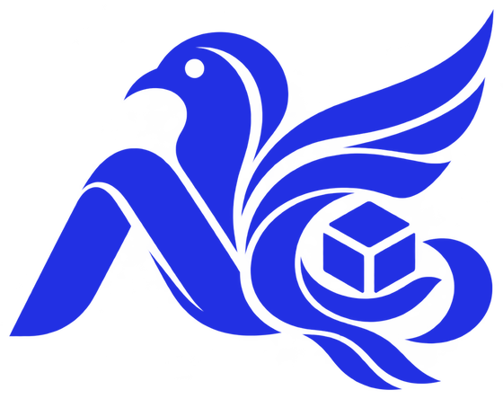

  

<h3 align="center">สร้างซอฟต์แวร์โอเพนซอร์สที่โหลดไปใช้ได้ฟรี ใช้ง่าย ดีไซน์ทันสมัย</h3>

<i>Free, open-source software that is easy to use and looks good doing it.</i>

  
  
  

---

<h2 id="projects">โปรเจกต์ / Projects</h2>

<table>
  <tr>
    <td width="55%" valign="top">
      
    </td>
    <td width="45%" valign="top">
      
      <h3><a href="https://github.com/NexwestLedgerCoreCompanyLimited/NeledPort">NeledPort</a></h3>
      
<b>เปิดเซิร์ฟเวอร์เกม Steam บนเครื่องตัวเองได้ในโปรแกรมเดียว</b> 
      Host Steam dedicated game servers from one modern desktop app.

      <ul>
        <li>ติดตั้งเซิร์ฟเวอร์ในคลิกเดียว ไม่ต้องพิมพ์คำสั่ง</li>
        <li>ดู log สด เตะ แบน ผู้เล่นได้ทันที</li>
        <li>ใส่ม็อดฝั่งเซิร์ฟเวอร์ และ Steam Workshop</li>
        <li>สำรองโลกเกมอัตโนมัติก่อนอัปเดต</li>
      </ul>
      

        
        
        
      

      

        
        
      

      Palworld · Rust · Valheim · Counter-Strike 2 · more coming
    </td>
  </tr>
</table>

โปรเจกต์ใหม่กำลังจะมาเพิ่ม กด <b>Follow</b> ไว้เพื่อไม่พลาด · More projects are on the way: follow to get notified.

---

## ร่วมสร้างไปด้วยกัน / Build it with us

ทุกโปรเจกต์เป็นโอเพนซอร์ส ใครก็ช่วยได้ ไม่ต้องเก่งโค้ดก็เริ่มได้

| อยากช่วยแบบไหน | เริ่มตรงนี้ |
|---|---|
| เพิ่มเกมที่คุณเล่นเข้า NeledPort (ไฟล์ JSON ไฟล์เดียว) | [Add a game](https://github.com/NexwestLedgerCoreCompanyLimited/NeledPort/blob/main/CONTRIBUTING.md#add-a-game) |
| เจอบั๊ก หรืออยากขอเกมใหม่ | [Open an issue](https://github.com/NexwestLedgerCoreCompanyLimited/NeledPort/issues/new/choose) |
| มีไอเดีย อยากคุย | [Discussions](https://github.com/NexwestLedgerCoreCompanyLimited/NeledPort/discussions) |
| ชอบโปรเจกต์ | กด Star ให้กำลังใจทีมงาน |

---

## เทคโนโลยีที่เราใช้ / Stack

  
  
  
  
  
  
  
  
  
  

## ติดต่อ / Contact

info@nexwest.co.th

© 2026 NEXWEST LEDGER CORE COMPANY LIMITED · จดทะเบียน 0805569001819
